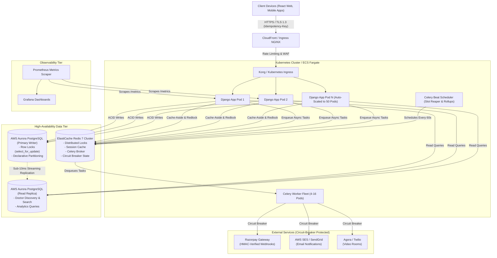
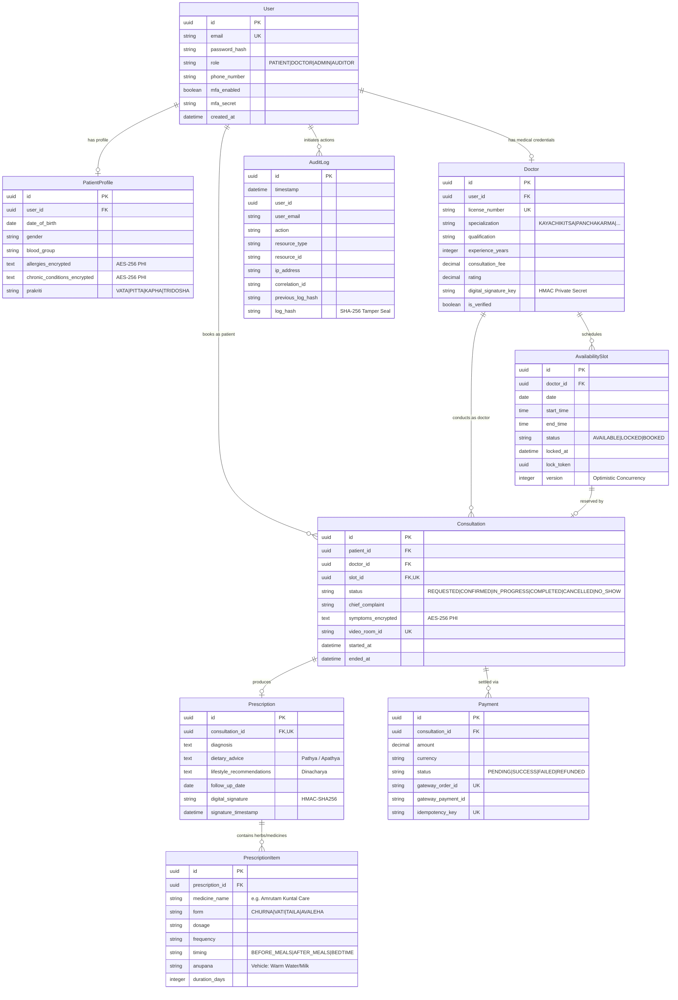

# Amrutam Telemedicine Backend - System Architecture Specification

## 1. Executive Summary & Design Goals
Amrutam's Telemedicine System is engineered as a production-grade, highly scalable, and fault-tolerant backend tailored for Ayurvedic consultations, holistic patient care, and pharmaceutical integrations.

### Key Performance & Availability Metrics
* **Scale Target:** Capable of sustaining **100,000 daily consultations** (peaking at ~350 requests per second with sustained throughput).
* **Latency SLA:**
  * **Reads (p95):** `< 200 ms` (leveraging Redis cache-aside and read-replica offloading).
  * **Writes (p95):** `< 500 ms` (using distributed locking, optimistic indexing, and asynchronous job queuing).
* **High Availability SLA:** **99.95% uptime** (~4.38 hours maximum unplanned downtime per year).
* **Data Integrity & Compliance:** Zero double-bookings under race conditions, exactly-once write idempotency, and tamper-evident audit trails compliant with **DISHA (Digital Information Security in Healthcare Act)** and **HIPAA Title II**.

---

## 2. High-Level Architecture & Data Flow



---

## 3. Booking Flow Sequence Diagram (Saga & Concurrency Protection)

The booking workflow implements a distributed Saga with two-phase slot reservation and payment settlement to guarantee **zero double-booking** under high concurrency:

```mermaid
sequenceDiagram
    autonumber
    actor Patient as Patient (React Client)
    participant API as Amrutam API Gateway / Backend
    participant Idemp as Idempotency Engine
    participant Redis as Redis Distributed Lock
    participant DB as PostgreSQL (select_for_update)
    participant Gateway as Payment Gateway (Razorpay/Stripe)
    participant Celery as Celery Async Task Worker

    Patient->>API: POST /api/v1/consultations/book/ [Header: Idempotency-Key]
    API->>Idemp: Check Idempotency-Key in DB/Cache
    alt Idempotency Hit (Duplicate / Retried Request)
        Idemp-->>API: Return Cached 201 Response
        API-->>Patient: Return Idempotent Booking Details (X-Cache-Lookup: HIT)
    else First-Time Request
        API->>Redis: Acquire Lock ("slot_reserve_lock_{slot_id}", TTL=5s)
        activate Redis
        API->>DB: BEGIN TRANSACTION; select * from availability_slot where id = :id FOR UPDATE;
        activate DB
        alt Slot Already Booked or Active Lock
            DB-->>API: Status = LOCKED / BOOKED
            API->>DB: ROLLBACK;
            API->>Redis: Release Lock
            API-->>Patient: HTTP 400 Conflict ("Slot unavailable")
        else Slot Available
            DB->>DB: UPDATE availability_slot SET status='LOCKED', locked_at=NOW(), version=version+1;
            DB->>DB: INSERT INTO consultations (status='REQUESTED', chief_complaint, symptoms_encrypted);
            DB-->>API: Commit Transaction
            deactivate DB
            API->>Redis: Release Lock
            deactivate Redis
            API-->>Patient: HTTP 201 Created (Reserved for 10 minutes)
            API->>Celery: Schedule slot_expiry_watchdog (10 min TTL)
        end
    end

    Patient->>Gateway: Complete Checkout Payment (INR 800)
    Gateway-->>API: POST /api/v1/payments/webhook/ (event: payment.captured)
    API->>DB: BEGIN TRANSACTION;
    API->>DB: UPDATE payments SET status='SUCCESS';
    API->>DB: UPDATE availability_slot SET status='BOOKED';
    API->>DB: UPDATE consultations SET status='CONFIRMED', video_room_id='amrutam-room-xyz';
    API->>DB: COMMIT;
    API-->>Gateway: HTTP 200 OK (Webhook Processed)
    API->>Patient: Push Notification: "Consultation Confirmed with Dr. Sharma"
```

---

## 4. Entity-Relationship (ER) Diagram



---

## 5. Retry & Backoff Strategies

1. **Celery Asynchronous Tasks (Exponential Backoff):**
   * Heavy tasks such as video room token generation, SMS/Email dispatch, and pharmacy prescription sync use exponential backoff with jitter to prevent thunderous herd problems on third-party gateways.
   * `default_retry_delay=5`, `max_retries=5`, `retry_backoff=True`, `retry_backoff_max=600`, `retry_jitter=True`.
2. **Circuit Breaker Pattern:**
   * Payment gateways and SMS aggregators are wrapped with a 3-state circuit breaker (`CLOSED` -> `OPEN` on 5 consecutive failures within 30s -> `HALF-OPEN` after 60s cooldown) to fail fast and prevent thread starvation.
3. **Payment Webhook Retries:**
   * Payment gateways retry webhooks at intervals (15s, 1m, 5m, 15m, 1h). The system's unique `idempotency_key` constraint on payments guarantees that repeated webhook delivery produces zero duplicated state transitions.

---

## 6. Data Partitioning & Sharding (Target: 100,000 Daily Sessions)

At **100,000 consultations per day**, the system records approximately **36.5 million consultations and audit logs per year**.

### Declarative Range Partitioning by Month
In PostgreSQL 16, the `consultations` and `audit_log` tables use monthly range partitioning:
```sql
-- Partitioning specification for consultations
CREATE TABLE consultations_partitioned (
    id UUID NOT NULL,
    created_at TIMESTAMP WITH TIME ZONE NOT NULL,
    patient_id UUID NOT NULL,
    doctor_id UUID NOT NULL,
    status VARCHAR(20) NOT NULL,
    ...
) PARTITION BY RANGE (created_at);

-- Monthly sub-partitions
CREATE TABLE consultations_y2026m01 PARTITION OF consultations_partitioned
    FOR VALUES FROM ('2026-01-01 00:00:00+00') TO ('2026-02-01 00:00:00+00');
CREATE TABLE consultations_y2026m02 PARTITION OF consultations_partitioned
    FOR VALUES FROM ('2026-02-01 00:00:00+00') TO ('2026-03-01 00:00:00+00');
```
* **Benefits:**
  * Query Planner applies **Partition Pruning**: Queries for recent bookings scan only the active month's partition index.
  * Cold data older than 7 years can be archived to AWS S3 Glacier via `pg_dump` and detached with zero locking of active partitions.

---

## 7. Caching and Concurrency Handling

1. **Redis Cache-Aside Pattern:**
   * Verified Doctor profiles, specialization listings, and daily availability slots are cached with a **300-second TTL**.
   * Cache invalidation is triggered immediately whenever a doctor creates, modifies, or books a slot via Django post-save signals or explicit service cache eviction.
2. **Concurrency Control:**
   * **Pessimistic Locking (`select_for_update`):** Used during the critical 200ms booking reservation window to enforce serialization at the database layer.
   * **Optimistic Locking (`version` column):** Used on `AvailabilitySlot` to detect concurrent stale updates.
   * **Redlock Distributed Mutual Exclusion:** Protects cache keys from cache stampedes during flash promotions or peak booking hours.

---

## 8. Transaction Management and Sagas

The Amrutam Telemedicine booking engine implements an **Orchestration Saga**:
* **Step 1: Reserve Slot:** Status becomes `LOCKED`.
* **Step 2: Initiate Payment:** Payment record created with unique idempotency key.
* **Step 3: Confirm Settlement:** On webhook capture, consultation transitions to `CONFIRMED`, video room is created, slot becomes `BOOKED`.
* **Compensating Transactions (Rollback):**
  * If the patient fails to pay within 10 minutes: Celery Beat reaper releases the slot back to `AVAILABLE` and marks consultation `CANCELLED`.
  * If the consultation is cancelled by doctor or patient: The slot is released back to `AVAILABLE`, and `PaymentService.refund_payment()` issues a refund credit to the patient's payment method.

---

## 9. Backup and Disaster Recovery (DR) Strategy

| Metric | Target | Implementation |
|---|---|---|
| **RPO (Recovery Point Objective)** | **< 5 Minutes** | AWS Aurora continuous streaming WAL logs backed up to S3 every 5 minutes. |
| **RTO (Recovery Time Objective)** | **< 15 Minutes** | Aurora Multi-AZ automatic failover (< 30s) + Automated Terraform Kubernetes disaster cluster rebuild. |

* **Active-Passive Multi-Region Standby:**
  * Primary Region: `ap-south-1` (AWS Mumbai).
  * Standby Region: `ap-south-2` (AWS Hyderabad).
  * Aurora Global Database replicates storage across regions in `< 1 second`.
  * Route 53 DNS Failover automatically points `api.amrutam.com` to Hyderabad if Mumbai healthchecks fail for 60 seconds.
